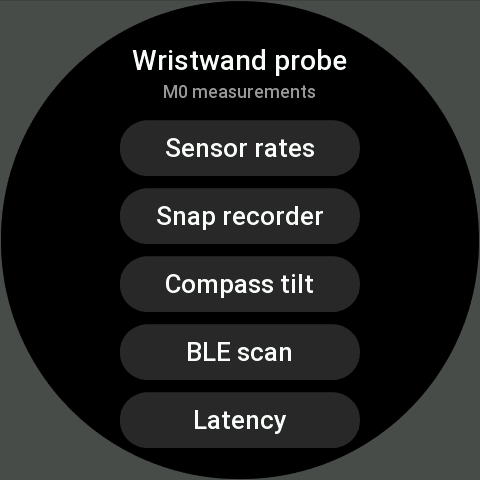

<p align="center"></p>

# Kestrel

Point your Amazfit watch at a smart-home device and trigger it. Hold your arm still on the lamp across the room, the way a kestrel hangs still in the wind over its target, then flick your wrist and the light comes on. An open-source pointing remote for Zepp OS watches, built around [Home Assistant](https://www.home-assistant.io/).

> **Status: feature-complete test builds, before release polish.** Pair the watch with Home Assistant, paint devices, point, and trigger with the select button, a tap or a gesture (wrist flick, finger snap or finger tap). Twist to dim lights. Rooms are recognised by Bluetooth (or a Home Assistant sensor). Away mode, paints, rooms and settings are managed in Home Assistant. There is no release yet.

<p align="center">
  
</p>

## How it will work

1. **Paint** each device once: sweep your arm across it for about 15 seconds.
2. **Point** at it. The watch shows what it thinks you mean.
3. **Trigger**: snap, flick, press a button or tap. A twist dims lights. Locks always ask for a confirming tap.

It works best with the Kestrel Home Assistant component: the watch pairs with a code instead of a copied token, lists your devices by area, keeps working away from home through Nabu Casa, and every action fires a `kestrel_fired` event for automations. Store installs will also be able to use Home Assistant without it (a URL and a long-lived token in the app's settings). See [docs/design.md](docs/design.md).

## Try the test build

Test builds are for development and change often.

**1. Install the Home Assistant component.** In HACS: ⋮ → Custom repositories → `https://github.com/raetha/zepp-kestrel`, type Integration, then open Kestrel. There's no release yet, so first turn on its test builds: ⋮ → Redownload → switch on **Show beta versions** → pick the newest `ha-v…-dev.N` → Download, then restart Home Assistant. (Each push to `dev` publishes a new one; HACS offers it as an update.) Or copy `custom_components/kestrel` from the `dev` branch into your HA config folder. Then Settings → Devices & services → Add integration → Kestrel.

**2. Install the watch app.**
1. In the Zepp app, turn on Developer Mode: Profile → Settings → About, tap the Zepp logo 7 times.
2. Open the [test-build page](https://raetha.github.io/zepp-kestrel/dev/) on another screen.
3. In the Zepp app: Profile → your watch → Developer Mode → scan icon (top right). Scan the QR code and confirm. It never changes and always installs the newest build; the home screen shows the build number at the bottom.

**3. Pair.** With your phone on the home Wi-Fi, open Kestrel DEV on the watch → Pair with HA. Pick your Home Assistant, then type the 6-digit code from the notification Home Assistant shows. The watch then fetches your devices. (If the Zepp app asks for Local Network access, allow it: that's how the phone finds `homeassistant.local`.)

**4. Paint and point.** Paint a device: pick it, stand where you'd use it, press Start, and sweep your arm slowly across it for 15 s, palm down. Then Point: hold your arm out at it, palm down. The circle turns green when the watch has it in mind; press the select button, tap the circle, or do your gesture to toggle it. Locks ask for a confirming tap. If the watch picked the wrong device, tap **Not it?** within 5 s: it undoes the first (lights, switches, fans and the like), toggles the right one, and remembers where you aimed. Dropping your wrist and raising it again brings Point back.

To test without your own devices nearby (at work, say), create a helper in Home Assistant (Settings → Devices & services → Helpers → Toggle), Sync, and paint something in the room, like a door frame, as that helper.

**5. Dim.** On a dimmable light, hold the select button (or a finger on the circle) and twist your wrist: thumb up brightens, thumb down dims, a quarter turn is the whole range. Let go to send it.

**6. Gesture.** More → Gesture: choose wrist flick, finger snap or finger tap, then Calibrate: five gestures after the buzzes, then a few seconds of slowly pointing around. The watch learns thresholds that separate your gesture from aiming. It only counts while you're aiming at something.

**7. Rooms.** More → Rooms lists your Home Assistant areas. Calibrate each room you point in: walk around it for three short Bluetooth scans. Paint devices afterwards, from inside each room: then the watch only considers devices painted in the room you're in, which keeps things apart that line up through walls. "Where am I?" tests it. If you already track rooms in Home Assistant (for example Bermuda), choose that sensor in the integration's options instead.

**Managing things in Home Assistant.** Settings → Devices & services → Kestrel → Configure:
- **Painted devices**: remove a bad paint (the newest spot) or all of a device's paints, or make a paint trigger a different entity.
- **Rooms**: delete a room's calibration.
- **Settings**: gesture on or off and its thresholds; **away mode** (while the chosen person isn't home, only the entities you allow work, so pointing at work doesn't switch things at home); where the current room comes from.

The watch picks changes up on its next Sync (it also syncs quietly each time the app starts). Paints, rooms and settings live in Home Assistant, so a reset or new watch gets them back on Sync.

The watch is offered every supported entity except hidden, disabled, and devices' configuration or diagnostic entities, up to 1000 (Sync shows "1000 of N devices" when some are left out). To offer only some devices, add the label `kestrel` to those entities or devices in Home Assistant, then Sync on the watch. Each paired watch appears in Home Assistant as a device under the Kestrel integration; delete the device to unpair it.

**On each watch's device page** in Home Assistant:

| Entity | What it shows |
| --- | --- |
| Last triggered | The device the watch last triggered; attributes say how (button, tap, flick, snap, dim), from which room and when. Handy for automations along with the `kestrel_fired` event. |
| Room | The room the watch last placed itself in (only updated while Kestrel is open). |
| Gesture trigger (switch) | Turns the flick/snap/tap trigger on or off, for example from an automation while you work out. |
| Away mode (switch) | Turns away mode on or off; pick the person and the allowed entities under Configure. |
| Last seen, Home Assistant address, Painted devices, Calibrated rooms | Diagnostics: when the watch last talked to Home Assistant, the address it used, and what it has set up. |

The device's software version is the watch app's build. Switch changes reach the watch on its next sync.

If your phone can't find Home Assistant (another port, or a name other than `homeassistant.local`), choose **Type address** on the watch and enter its IP address, with `:port` if it isn't 80 or 8123.

### Running the M0 probes

Under **More → Probes** on the watch. Results show on the watch, and once the watch is paired each one (raw sensor traces included) also goes to Home Assistant; the probe screen says whether it got there. To hand results over, download them in one file: Settings → Devices & services → Kestrel → your watch's device → ⋮ → **Download diagnostics**. Home Assistant keeps the newest 500 results. Each also fires a `kestrel_probe` event, for watching live in Developer tools → Events. The select button presses the main button on every probe screen; back returns to the list.

| Probe | What to do | What it answers |
| --- | --- | --- |
| Sensor rates | Start, then keep the watch moving gently for 45 s | Real rates of the accelerometer and gyro in each mode, and the compass |
| Snap recorder | Arm out, pick a gesture, Record, gesture after the buzz. About 10 each of snap, finger tap, wrist flick, arm wave, nothing | Whether a snap leaves a spike that stands apart from other movement |
| Compass tilt | **Up and down**: point along one vertical line (a door frame or wall edge), following the buzzes: level, higher, lower, level. **Wrist roll**: point at one spot, turn the wrist in, then out. 12 s each | Whether the compass heading holds as the arm tilts and the wrist turns |
| BLE scan | In each room, pick a label and Scan | How many steady Bluetooth devices each room has |
| Latency | Run, with HA set up | Watch ↔ phone and phone ↔ HA round trips (target: under 500 ms) |

## Development

See [docs/development.md](docs/development.md): layout, emulator, branches, test builds and releases.

```bash
npm install && npm test
cd watch && zeus build
```

## Support

If you find this useful, you can [sponsor the project](https://github.com/sponsors/raetha).

## License

- **The watch app** (`watch/`): [CC BY-NC-SA 4.0](LICENSES/CC-BY-NC-SA-4.0.txt). Share and remix it non-commercially with credit, but don't sell it or its derivatives.
- **The Home Assistant component** (`custom_components/kestrel/`), **generic helpers** (`lib/`) **and tooling** (`tools/`, CI): [MIT](LICENSES/MIT.txt).
- **The name "Kestrel"** and its icon aren't licensed for reuse.

Details are in [LICENSE](LICENSE). Kestrel is an independent project and is not affiliated with Zepp Health, Amazfit or Home Assistant.
